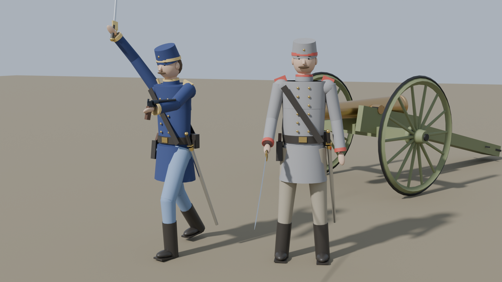
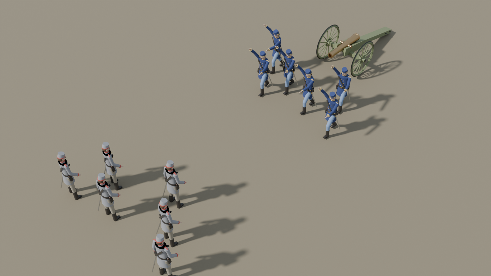

# RTS Assets (v1)

First-pass unit models for the RTS, built by script in Blender 5.2.




## Contents

| File | What it is | Faces |
|---|---|---|
| `Models/SK_Soldier_Blue.fbx` | Rigged soldier, blue team colors | ~2.5k |
| `Models/SK_Soldier_Grey.fbx` | Same soldier, grey/red team colors | ~2.5k |
| `Models/SM_Saber.fbx` | Drawn cavalry saber (pivot at the grip) | 138 |
| `Models/SM_Revolver.fbx` | Revolver (pivot at the grip, barrel forward) | 144 |
| `Models/SM_FieldCannon.fbx` | Bronze 12-pdr style field gun on carriage | ~1.7k |
| `Models/*.glb` | Same models as glTF, for quick viewing | |
| `Blend/rts_assets.blend` | Everything in one Blender file (posed for the previews) | |
| `scripts/build_assets.py` | Rebuilds all of the above | |

Modelled in centimeters: soldier is 180 cm tall, cannon wheels are 147 cm across.

## Importing into Unreal

1. Drag the `.fbx` files into the Content Browser.
2. Soldiers: import as **Skeletal Mesh**. Leave scale at 1.0. Import the Blue one first, then for
   the Grey one pick the Blue soldier's skeleton under **Skeleton** so both share one skeleton.
3. Weapons and cannon: import as **Static Mesh**.
4. Team colors live in the `M_Coat_*`, `M_Trousers_*`, `M_Hat_*` and `M_Trim_*` material slots, so
   you can also use just one soldier mesh and swap material instances per team.

## Skeleton and animations

Bones use the UE5 mannequin names (`root`, `pelvis`, `spine_01..03`, `neck_01`, `head`,
`clavicle_l`, `upperarm_l`, `lowerarm_l`, `hand_l`, `thigh_l`, `calf_l`, `foot_l`, `ball_l`, and `_r`
versions). That lets the **IK Retargeter** auto-map the stock UE5 mannequin animations (walk, run,
idle) onto the soldier.

Skinning is rigid (each body part follows one bone), which reads fine from an RTS camera but
creases at joints in close-ups. Good upgrade path later: put the uniform and gear on a
properly skinned base body.

To hold weapons, add sockets on `hand_r` / `hand_l` and attach `SM_Saber` / `SM_Revolver`.

## Rebuilding

```
pip install bpy          # Python 3.13 needed for bpy 5.2
python scripts/build_assets.py <output_dir>          # add --no-render to skip previews
```
